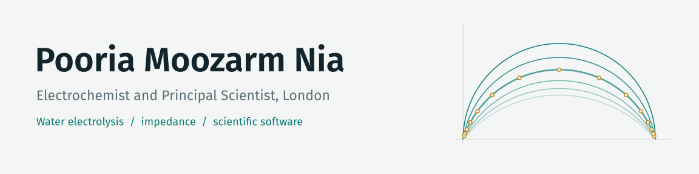

<picture>
  <source media="(prefers-color-scheme: dark)" srcset="assets/profile-banner-dark.svg">
  
</picture>

I'm an electrochemist with a PhD in analytical chemistry and more than ten years in academic and industrial R&D. Most of that time has gone into electrochemical energy: water electrolysis, batteries, fuel cells and redox flow, from electrode materials and impedance diagnostics through to test rigs, stack development and scale-up.

I also write a lot of software. Developing the technology turns out to be only half the job. Someone still has to run the experiments, make sense of the data and keep the whole process working, and that's the part I like building tools for.

### What I'm working on in public

**[Electrochemical Engineering Toolkit](https://github.com/pooriamn/electrochem-toolkit)** is a Python package for the calculations I keep needing: impedance fitting with proper model comparison, electrolyser stack and electrothermal models, and measurement reports that refuse bad input files. Every equation is written down and every result that matters has a test.

There's also a [browser version](https://pooriamn.github.io/electrochem-toolkit/) where you can drag a constant-phase exponent and watch an impedance arc flatten.

 

### Where my time goes

| In the lab and on the plant | At the keyboard |
| --- | --- |
| Water electrolysis (alkaline in particular), batteries, fuel cells, redox flow | Python and MATLAB for modelling and data analysis |
| Electrode engineering, EIS, kinetics and durability | Impedance fitting, parameter estimation, time-series analysis |
| Test rigs, instrumentation and stack validation | Instrument integration, data pipelines and automated testing |
| Process development and industrial scale-up | Engineering dashboards and workflow automation |

### Elsewhere

Papers are on [Google Scholar](https://scholar.google.com/citations?user=SaiB5-8AAAAJ) and [ORCID](https://orcid.org/0000-0002-3049-3120). I'm on [LinkedIn](https://uk.linkedin.com/in/pooriamn) for work, and on [Instagram](https://www.instagram.com/pooriamn/) when I've been out with a camera, usually photographing architecture, light and perspective.

Based in London. Happy to talk about electrolysis, EIS or lab automation; open an issue on any of my repos or find me on LinkedIn.
