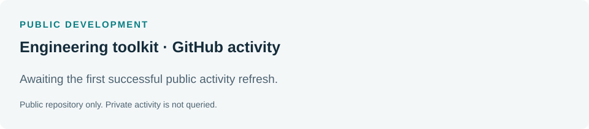

# Pooria Moozarm Nia

**Electrochemist & Principal Scientist | Electrochemical engineering, software & automation**

I'm an electrochemist with a PhD in Analytical Chemistry and more than a decade of experience in academic and industrial R&D. Most of my work has been in electrochemical energy technologies, from electrode materials and electrochemical diagnostics to test rigs, cell and stack development, and industrial scale-up.

I also write software. I often find that developing the technology is only half the job: someone still has to run the experiments, make sense of the data and keep the whole process working. That's the part I enjoy building around.

## What I work on

| Electrochemistry & engineering | Software & automation |
| --- | --- |
| Water electrolysis, batteries, fuel cells and redox-flow systems | Scientific applications and numerical modelling in Python and MATLAB |
| Electrode engineering, EIS, kinetics and durability | Impedance fitting, parameter estimation and time-series analysis |
| Experimental rigs, instrumentation and stack validation | Instrument integration, APIs, data pipelines and automated testing |
| Process development and industrial scale-up | Engineering dashboards, workflow orchestration and platform development |

I like writing tools that are useful long after the first experiment: code that can be tested, maintained and used by someone else without having to reconstruct the original workflow.

## Public engineering workbench

I've collected the examples into an [installable Python toolkit](toolkit/README.md), with a shared calculation layer, command-line tools and a [browser workbench](docs/toolkit.html). The aim is to make common engineering calculations easy to repeat and integrate into other tools.

[Changelog](CHANGELOG.md) · [Releases](https://github.com/pooriamn/pooriamn/releases) · [Development notes](journal/README.md) · [Reusable snippets](snippets/README.md)

## A few things you can try

| Project | What it does |
| --- | --- |
| [Electrochemical analysis](projects/electrochemical-analysis/README.md) | Fits a simple equivalent circuit to synthetic impedance data and recovers its parameters. |
| [Electrolyser calculator](projects/electrolyser-calculator/README.md) | Works out a stack's DC power, hydrogen output and specific energy from a few operating inputs. |
| [Experimental data pipeline](projects/experimental-pipeline/README.md) | Checks a measurement file, integrates its energy and writes a repeatable report. |

These examples are deliberately small. They use synthetic data and standard equations, so you can run them without access to laboratory equipment or proprietary software.

[Run the examples](projects/README.md) · [Portfolio website source](docs/index.html)

## Development activity

[Public activity details](activity/README.md) · [Issues](https://github.com/pooriamn/pooriamn/issues) · [Pull requests](https://github.com/pooriamn/pooriamn/pulls)

The activity summary reports only this public repository. My private work remains private.

## Publications & profiles

[Google Scholar](https://scholar.google.com/citations?user=SaiB5-8AAAAJ) · [ORCID](https://orcid.org/0000-0002-3049-3120) · [LinkedIn](https://uk.linkedin.com/in/pooriamn) · [Instagram](https://www.instagram.com/pooriamn/)

I'm based in London, UK. Away from work, I spend a fair amount of time with a camera, mostly photographing architecture, light and perspective.
