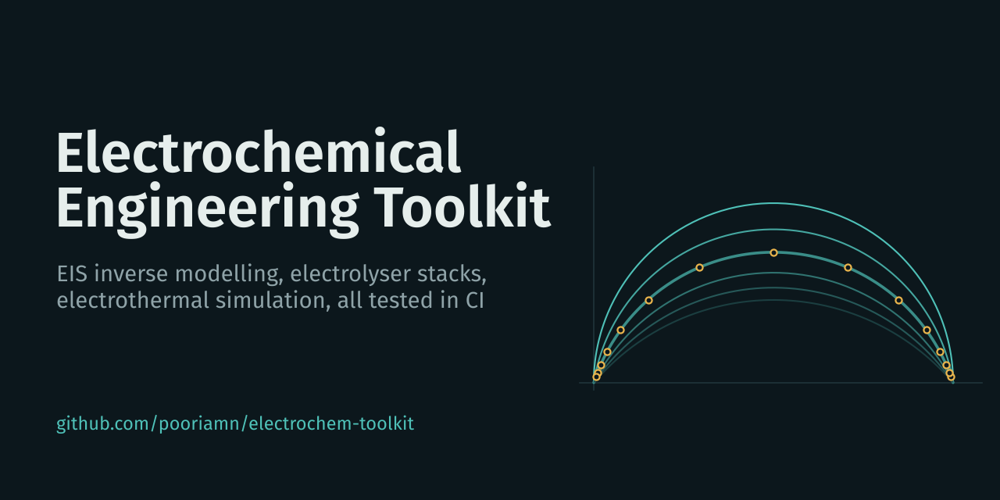

<picture>
  <source media="(prefers-color-scheme: dark)" srcset="assets/profile-banner-dark.svg">
  
</picture>

I'm an electrochemist with a PhD in analytical chemistry and more than ten years in academic and industrial R&D. Most of that time has gone into electrochemical energy: water electrolysis, flow batteries, fuel cells and energy storage, from electrode materials and impedance diagnostics through to test rigs, stack development and scale-up.

I also write a lot of software. Developing the technology turns out to be only half the job. Someone still has to run the experiments, make sense of the data and keep the whole process working, and that's the part I like building tools for.

### What I'm working on in public

**[Electrochemical Engineering Toolkit](https://github.com/pooriamn/electrochem-toolkit)** is a Python package for the calculations I keep needing, with the equations written down and every result that matters tested. It includes five studies, each built on synthetic data with a known answer, so the method can be judged on whether it gets that answer back:

- [Impedance fitting](https://github.com/pooriamn/electrochem-toolkit/tree/main/studies/eis-inverse): when is a constant-phase element actually justified?
- [Electrolyser heat balance](https://github.com/pooriamn/electrochem-toolkit/tree/main/studies/electrothermal-stack): where the heat goes in a stack under a step load
- [Vanadium flow battery](https://github.com/pooriamn/electrochem-toolkit/tree/main/studies/flow-battery): how hard to pump, and what remixing really recovers
- [Corrosion rate](https://github.com/pooriamn/electrochem-toolkit/tree/main/studies/corrosion): when Tafel extrapolation and LPR can be trusted, and when they can't
- [Tafel analysis](https://github.com/pooriamn/electrochem-toolkit/tree/main/studies/tafel-analysis): one sweep, six slopes, and what to report instead

You can also [try it in the browser](https://pooriamn.github.io/electrochem-toolkit/). Drag the constant-phase exponent and watch an impedance arc flatten. Every release is archived on Zenodo, so it can be cited: [doi:10.5281/zenodo.24407002](https://doi.org/10.5281/zenodo.24407002).

 

### Selected papers

- Novel polyolefin based alkaline polymer electrolyte membrane for vanadium redox flow batteries. *Journal of Power Sources*, 2019. [doi](https://doi.org/10.1016/j.jpowsour.2019.03.108)
- Electrodeposited reduced graphene oxide as a highly efficient and low-cost electrocatalyst for vanadium redox flow batteries. *Electrochimica Acta*, 2019. [doi](https://doi.org/10.1016/j.electacta.2018.11.109)
- Self-assembled heteropolyacid on nitrogen-enriched carbon nanofiber for vanadium flow batteries. *Nanoscale*, 2018. [doi](https://doi.org/10.1039/C8NR02450B)
- Phosphoric acid doped composite proton exchange membrane for hydrogen production in medium-temperature copper chloride electrolysis. *International Journal of Hydrogen Energy*, 2020. [doi](https://doi.org/10.1016/j.ijhydene.2019.10.030)
- Tunable electrochemical approach for reduction of graphene oxide: Taguchi-assisted chemical and structural optimization. *Journal of The Electrochemical Society*, 2018. [doi](https://doi.org/10.1149/2.0031810jes)
- Comparative study on the corrosion and wear behavior of plasma-sprayed vs. high velocity oxygen fuel-sprayed Al8Si20BN ceramic coatings. *Ceramics International*, 2018. [doi](https://doi.org/10.1016/j.ceramint.2018.03.275)

The full list of 29 papers is on [Google Scholar](https://scholar.google.com/citations?user=SaiB5-8AAAAJ) and [ORCID](https://orcid.org/0000-0002-3049-3120).

### Where my time goes

| In the lab and on the plant | At the keyboard |
| --- | --- |
| Water electrolysis (alkaline in particular), flow batteries, fuel cells, energy storage | Python and MATLAB for modelling and data analysis |
| Electrode engineering, EIS, kinetics and durability | Impedance fitting, parameter estimation, time-series analysis |
| Test rigs, instrumentation and stack validation | Instrument integration, data pipelines and automated testing |
| Design of experiments, process development and scale-up | Engineering dashboards and workflow automation |

### Elsewhere

I'm on [LinkedIn](https://uk.linkedin.com/in/pooriamn) for work, and on [Instagram](https://www.instagram.com/pooriamn/) when I've been out with a camera, usually photographing architecture, light and perspective.

Based in London. I'm always happy to talk about electrolysis, flow batteries, EIS or lab automation. Open an issue on the toolkit, or find me on LinkedIn.
