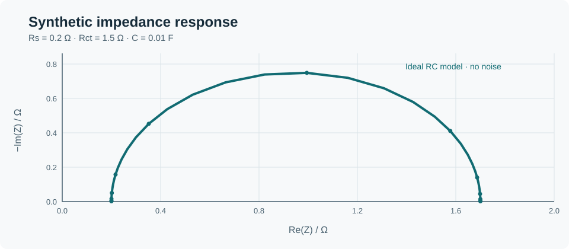

# Electrochemical analysis

When interpreting an impedance spectrum, I like to start with the simplest circuit that can explain the response before adding more parameters. This example uses a series resistance and a parallel resistance–capacitance element.



## Run it

From the repository root:

```sh
python projects/electrochemical-analysis/impedance.py
```

The script generates a noise-free synthetic spectrum, fits it with a bounded grid search and prints the recovered values of Rs, Rct and C alongside the mean squared complex residual.

## The model

`Z(f) = Rs + Rct / (1 + j·2πf·Rct·C)`

Frequency is in Hz, resistance in Ω and capacitance in F. The synthetic values are Rs = 0.2 Ω, Rct = 1.5 Ω and C = 0.01 F. The characteristic frequency is 1/(2πRctC), approximately 10.61 Hz.

The fitting routine is intentionally transparent and has no external dependencies. It searches the supplied parameter grids; it is not a general-purpose optimiser.

## What to watch for

Real impedance spectra may include diffusion, inductance, non-ideal capacitance and changes in the operating state. A low residual on its own is not evidence that the fitted circuit represents the actual mechanism. Check the model assumptions, parameter identifiability, residuals and measurement validity before interpreting real data.

[Source code](impedance.py) · [Verification tests](../../tests/test_demos.py)
