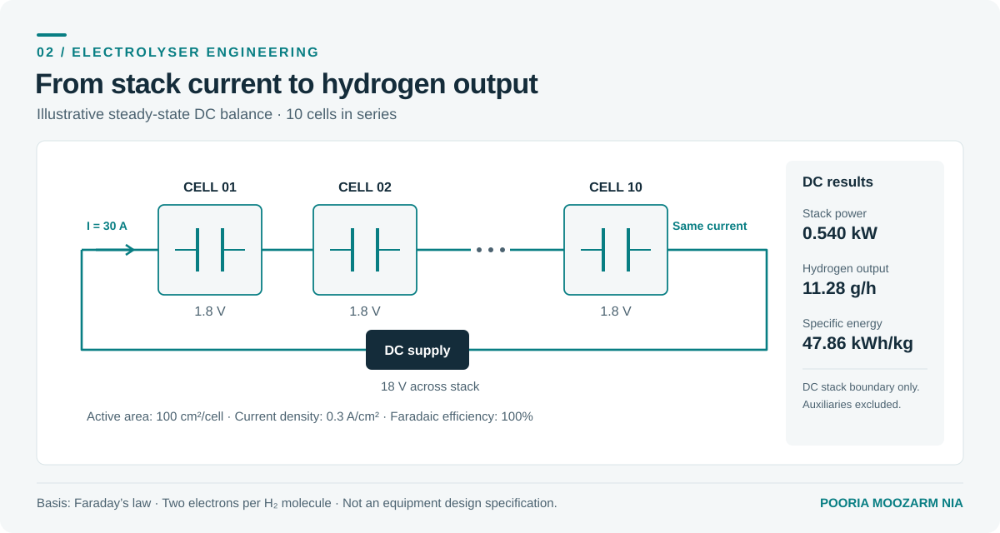

# Electrolyser calculator

A quick stack balance is often useful before starting a more detailed model. Given the cell area, current density, cell voltage and number of cells, this calculator estimates the stack's electrical load and hydrogen output.



## Run it

From the repository root:

```sh
python projects/electrolyser-calculator/stack.py --cells 10 --area 100 --current-density 0.3 --voltage 1.8
```

The example uses ten identical cells, 100 cm² of active area per cell, 0.3 A/cm² and 1.8 V per cell. Faradaic efficiency defaults to 100%; use `--efficiency 0.95` to specify 95%.

## How it works

| Quantity | Calculation |
| --- | --- |
| Stack current | Active area × current density |
| Stack voltage | Number of cells × cell voltage |
| DC power | Current × stack voltage |
| H₂ production (kg/h) | Number of cells × current × Faradaic efficiency × 3600 × molar mass / (2 × Faraday constant) |
| DC specific energy | DC power in kW / H₂ production in kg/h |

The molar mass of hydrogen is 0.00201588 kg/mol; the Faraday constant is 96485.33212 C/mol.

## Limits

The voltage is an input, not a prediction. The calculator assumes identical series-connected cells at steady state. It excludes AC conversion losses, auxiliary loads, pressure, heat transfer, gas crossover and purity. It is a DC stack balance, not an equipment sizing or safety assessment.

[Source code](stack.py) · [Verification tests](../../tests/test_demos.py)
