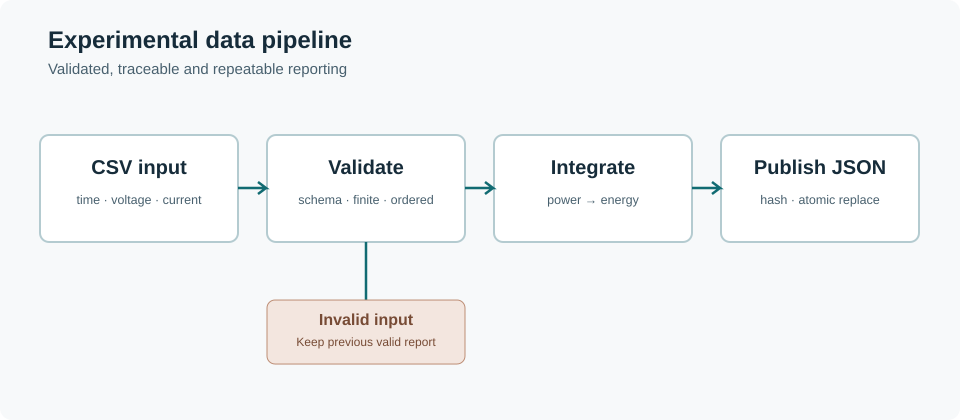

# Experimental data pipeline

A surprising amount of experimental work still involves opening spreadsheets, checking columns and repeating the same calculations. This example turns a small part of that process into a repeatable command.



## Run it

From the repository root:

```sh
python projects/experimental-pipeline/pipeline.py projects/experimental-pipeline/sample.csv summary.json
```

The input is a synthetic measurement file with three columns: time in seconds, voltage in volts and current in amperes. The script checks the header and values, calculates power at each sample, integrates the energy and writes a JSON report.

## A few design choices

- Timestamps must increase strictly, and all measurements must be finite and non-negative. Invalid data is rejected rather than silently corrected.
- Energy is integrated using the trapezoidal rule on the sample powers. Nothing is extrapolated or filled in.
- The SHA-256 digest of the input file is included in the report, so the exact source can be identified.
- A report is written to a temporary file before replacing the destination. Invalid input leaves the previous report unchanged.

Running the same input twice produces the same JSON. That makes the result easier to test, compare and trace back to the original measurement file.

This is an offline processing example, not an instrument controller or a substitute for an experimental validation procedure.

[Source code](pipeline.py) · [Sample input](sample.csv) · [Verification tests](../../tests/test_demos.py)
