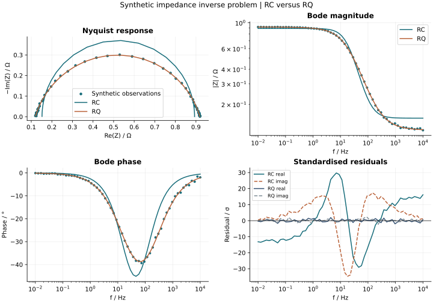

# Electrochemical inverse modelling

An impedance spectrum can support several equivalent circuits, and a small residual does not settle the question. This study compares a simple RC circuit with its non-ideal RQ extension using a synthetic spectrum with known parameters and independent Gaussian measurement noise.

## Physical model

Both circuits have a series resistance and a parallel resistance/reactive element:

```text
Z = Rs + R / (1 + R Q (jω)^α)
```

The RC model fixes α = 1, with Q = C in farads. In the RQ model Q has units S·s^α and α is bounded between 0.2 and 1. R and Rs are in ohms. The power uses the principal complex branch for positive frequency.

## Numerical approach

- Stack the real and imaginary residuals, each divided by its known measurement standard deviation.
- Optimise log-transformed positive parameters and bounded α using SciPy trust-region reflective least squares.
- Supply an analytic complex Jacobian and test it against central finite differences.
- Use seeded multistart initialisation; retain the converged solution with the lowest weighted residual.
- Compare RC and RQ by AICc on identical observations and known channel variances.
- Inspect Jacobian rank, singular-value condition number, parameter bounds and local standard errors from the inverse Fisher information.

The uncertainty is local and conditional on the specified noise model. Correlated noise, unknown noise variance, model discrepancy, calibration errors and parameters on bounds require different inference. AICc near the nested boundary α = 1 is a heuristic comparison, not a formal likelihood-ratio test.

## Reproduce the study

```sh
python -m pip install ".[advanced]"
python studies/eis-inverse/run.py
```

The script creates 60 logarithmically spaced frequencies (0.01 Hz to 10 kHz), synthetic RQ parameters Rs = 0.12 Ω, R = 0.8 Ω, Q = 0.025 S·s^α, α = 0.82, and 2 mΩ independent noise per channel. It prints parameters, standard errors, AICc and conditioning, and writes a JSON report and a four-panel figure to a local output directory.



## Scientific limits

This does not establish that a measured spectrum is linear, stationary or causal. A real EIS workflow should check experimental conditions and Kramers–Kronig consistency before interpreting the fit; it should also examine weighting, residual structure, parameter identifiability and alternative physical models. No diffusion, inductance or distributed relaxation-time inversion is included here.

[Implementation](../../src/electrochem_toolkit/inverse.py) · [Verification tests](../../tests/test_advanced_models.py)
