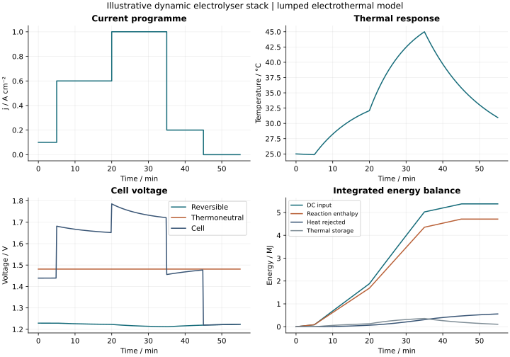

# Dynamic electrolyser electrothermal model

An electrical balance alone cannot describe the temperature response of a stack. This study couples electrochemical voltage losses with a lumped thermal balance and integrates the response to a piecewise constant current profile.

## Model equations

For liquid-water electrolysis, approximate standard reaction enthalpy and entropy are held constant near 298 K: ΔH = 285.830 kJ/mol H₂ and ΔS = 163.34 J/(mol·K).

```text
Erev = (ΔH − T ΔS)/(2F) + RT/(2F) ln(pH2 pO2^0.5)
Etn  = ΔH/(2F)
j0(T) = j0_ref exp[−Ea/R (1/T − 1/Tref)]
ASR(T) = ASR_ref exp[Eohm/R (1/T − 1/Tref)]
Vcell = Erev + (2RT/F) asinh(j/(2j0)) + j ASR(T)
I = j A
Pdc = N I Vcell
nH2 = N I/(2F)
Cth dT/dt = Pdc − nH2 ΔH + Pheater − UA(T − Tamb)
```

Pressures are divided by the 1 bar standard state; liquid water activity is unity. The apparent symmetric Butler–Volmer term lumps electrode kinetics together and is not a separately calibrated HER/OER model. The ohmic term uses area-specific resistance in Ω·cm².

At 100% Faradaic efficiency, the reaction enthalpy is the chemical energy boundary; the heat source can be positive or negative depending on the difference between cell voltage and thermoneutral voltage. Gas compression, sensible enthalpy of flows, evaporative loss, crossover and auxiliaries are excluded.

## Numerical implementation

The model uses immutable parameter sets, explicit input validation, piecewise integration with SciPy solve_ivp, and event termination if the temperature leaves 273.15–373.15 K. Electrical, chemical, heater and rejected-heat energies are integrated as additional ODE states.

A conservation residual checks:

```text
E_dc − E_chemical + E_heater − E_loss − Cth(T − Tinitial) = 0
```

Tests include the reversible/thermoneutral reference values, the Nernst pressure correction, Arrhenius ohmic behaviour, analytical passive cooling, adiabatic energy conservation and model-domain termination.

## Reproduce the study

```sh
python -m pip install ".[advanced]"
python studies/electrothermal-stack/run.py
```

The script writes a time series, energy summary and four-panel figure. It uses a 20-cell, 100 cm² illustrative stack and a sequence of current-density steps. Parameters are synthetic; the output is a numerical demonstration, not an industrial performance forecast.



## Where this model stops

A real stack requires measured kinetic and ohmic parameters, validated thermal and flow boundaries, temperature/pressure-dependent thermodynamics, gas management, nonuniform current distribution and independent experimental validation. The constant ΔH/ΔS approximation is limited to the stated temperature interval. The model is not an equipment controller, safety assessment or operating recommendation.

[Implementation](../../src/electrochem_toolkit/electrothermal.py) · [Verification tests](../../tests/test_advanced_models.py)
